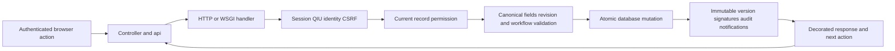
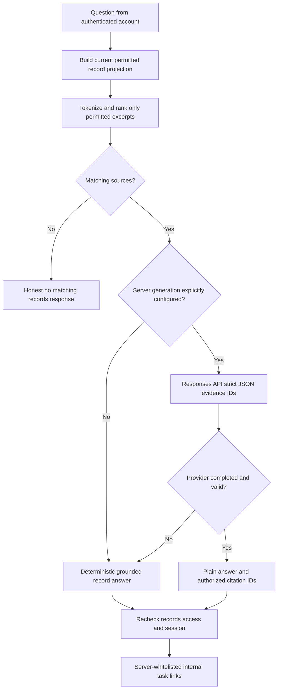

# Architecture and reverse engineering guide

This document explains how to reconstruct the implemented QIU Student Life Division workflows from source, database records, APIs and verification scripts. The source is readable Python and vanilla JavaScript; it is not obfuscated. Local preview is separate from production credentials and data. The system is an operational prototype with MySQL production support, not a university deployment verified on Exabytes.

## Start from a user action

1. Find the feature in FUNCTION_FLOWS.md and the corresponding role manual.
2. Find its frontend named controller in web/app.js using SOURCE_REFERENCE.md. Follow api() to its request path; check editable-field allowlists before autosave or recovery.
3. Find Handler.do_GET/do_POST in server.py. Authentication, CSRF, current session and mutation locking happen here. Domain handlers dispatch to finance.py, club_reports.py, performance.py and assistant.py.
4. Follow the handler's permission and canonicalization helpers before any write. Read exact record kind/key, revision guard, state transition, server timestamp and atomic batch.
5. Follow App.get/all/put/put_batch to storage.py. Production uses InnoDB JSON records, shared encrypted sessions and the database mutation lock. Preview uses SQLite without changing university data.
6. Follow export calls to exports.py and retained templates. Signature data comes from immutable server attestations, not the downloading user or a typed date.
7. Run the named regression script in an isolated temporary database. SOURCE_REFERENCE.md inventories all application/support Python functions, named frontend functions, observed route literals, imports, source hashes and tests. Rebuild it with python tools/build_reference.py after source changes.

## Module map

| Source | Responsibility | Important boundaries |
|---|---|---|
| server.py | HTTP service, authentication/CSRF dispatch, core club/proposal/admin workflows, profile decoration and audit | Verify session again under mutation lock; authenticated role and current assignments govern access |
| auth.py | Google OAuth, QIU identity/directory mapping and fictional local personas | University person type is not SLD authority; missing provider fields are explicit |
| storage.py | SQLite/MySQL records, transactions, process-wide database locking, encrypted durable sessions | Rollback all workflow writes together; no production SQLite fallback |
| wsgi.py / passenger_wsgi.py | Socket-free hosting adapters | Same application logic as local HTTP; hosting does not run a second HTTP listener |
| club_reports.py | Weekly/AGM canonical forms, progress, four-stage attestation and controlled handover | Current assignment plus frozen signer assignment; one immutable signature per slot/version |
| performance.py | Operational year/month/day calendar and public approved-event projection | Administrative saves and finance amounts never count as activity occurrences |
| finance.py | Private evidence, actual accounts, opening balances, SLD-approved postings and financial graphs | Proposed budgets do not post; evidence is event-scoped; once-only ledger approval |
| notifications.py | Durable per-recipient alerts and current access checks | Removed assignment hides old alerts; autosave does not spam notices |
| assistant.py | Permission-first corpus projection, BM25 retrieval, grounded answers and optional generation | No global private index/cache; no provider tools; context and session rechecked after generation |
| exports.py | Source-format proposal/AGM/minutes Word/PDF, sports attendance and financial/profile PDF | Current version/digest/slot required for signature images; historical audit is distinctly labelled |
| calendar_export.py | Scoped ICS output | Escape/fold values; approved calendar data only |
| web/app.js | Role navigation, forms, controllers, recovery, deep links, signatures, assistant and calendars | Server remains authority; safely escape content; flush pending edits before navigation |
| web/styles.css / tokens.css | Institutional visual system and responsive layouts | Preserve visible focus, local table overflow and scroll/focus across same-record updates |
| tools/* | Setup, diagnostic, migration, backup and source-reference utilities | Operator commands are explicit; secrets stay outside public files and documentation |

## Request flow

## Persistent model

The same record envelope is used in SQLite and MySQL: kind, record identifier and JSON payload. The migration does not require a second independent schema for each module. Existing SQL schema/indexes and transaction/session contracts remain in SPECIFICATION.md and EXABYTES_HOSTING.md. An immutable version is a separate record, never a mutable status flag.

| Kind | Identifier | Purpose |
|---|---|---|
| club / registration_grant | Generated record ID | Profile/committee and one-use creation permission |
| club_version | club ID plus submitted revision | Original registration snapshot and digest |
| proposal / proposal_version | Proposal ID / proposal ID-rN | Event content and submitted immutable snapshot |
| proposal_signature | proposal ID-rN-slot | Preparer/advisor/SLD frozen identity, drawn PNG, server time and digest |
| club_report | Report ID | Weekly/AGM current workflow record |
| club_report_version | report ID-rN | Frozen submitted report and signer assignments |
| club_report_signature | report ID-rN-slot | President/Secretary/Advisor/SLD frozen attestations |
| calendar_event | Proposal ID | Approved planned event used for scheduling/public event projection |
| receipt | Evidence ID | Private event file bytes and metadata; absent from assistant context |
| finance_report / finance_version | Report ID / version ID | Actual financial rows and frozen submission |
| ledger_entry / finance_opening | Posting ID / club ID | Approved actual balance inputs only |
| notification / notification_assignment | Recipient-specific hash / assignment key | Durable alerts and no-repeat assignment tracking |
| assistant_rate | SHA-256 of account email | Shared 12-query/minute throttle; no question/answer transcript |
| report_creation | Account/club/UUID hash | Draft creation replay guard |

All recorded timestamps use server UTC; interfaces and export signing dates display Malaysia time. Users may enter planned proposal schedules or actual report activity dates. An editable activity date is different from a signing date. Corrections generate a new submitted revision; historical signatures/digests survive. Deleting or editing client JSON cannot change authoritative snapshots.

## Assistant architecture

Retrieval is local BM25 lexical ranking with Unicode tokens and Chinese bigrams; it is not a vector/embedding index. This keeps the current Exabytes/Python/MySQL path independent of a vector service. Up to eight matching source excerpts are returned; matching_count and has_more identify larger results. Exact count questions use deterministic counts. Source projections omit file bytes, signature images, tokens and private directory contact catalogs. Each question is freshly scoped; client history is not accepted as private evidence.

Optional generation uses the configured OpenAI Responses endpoint, a server-held key, chosen model, strict answer/source_ids schema, no tools and store:false. Only retrieved authorized excerpts are sent. A configured key alone does not enable external generation: SLD_ASSISTANT_GENERATION_ENABLED must explicitly be true. Payload and error paths are tested with a stub, not a live provider. Data retention and university approval must be established by the university before enabling this on real data; store:false is not a claim of zero provider retention. See ASSISTANT_SETUP.md.

## Export reconstruction

Retained originals: event-proposal.docx, agm-report.docx and meeting-minutes.docx. Markdown sidecars and ingestion manifest document the supplied sources. Source files are unchanged. Fill mapped document XML, clone repeated table rows and add PNG/relationship/content-type parts for signatures and club logo. Intentional club-logo substitutions can modify the mapped header part; original QIU artwork, source media, styles and other unrelated parts remain intact. Sports reports use the supplied attendance columns in a clearly generated report because no combined four-signature source PDF was supplied.

AGM source secretary Prepared by, President Checked by and Advisor Reviewed by cells retain their meanings even though workflow signing starts with President. SLD verification is separately added. Meeting minutes retain purpose, discussion, actions and next-meeting sections; examples are removed and the four signers occupy distinct rows. Source blank spacing and explicit false cantSplit properties were corrected in generated copies to avoid empty pages and split signatures. The professional logbook lists server time, action, recorded signer, submitted version, review note and per-version digest.

## Reproduce locally

Install requirements.txt in a Python environment, run python server.py --preview --port 8765, then use the seven fictional personas. Execute tests/test_*.py sequentially (test_mysql.py requires the explicitly isolated loopback QA instance and --port). Run tests/test_*.js with Node. Never run the disposable MySQL integration suite against a university hosting database. For production diagnostics/migration/staging use EXABYTES_HOSTING.md.

Boundary cases already covered include stale saves, competing preparers, self-review, blank signatures, immutable historical evidence, removed assignments, handover conflicts, multi-day activities, provider fallback and context revocation during generation. Controller tests do not establish rendered browser scrolling, keyboard/mobile quality, live Google identity or deployment performance. Those acceptance checks remain outstanding under the prior browser refusal and missing university environment.

## Profiles, compact chat and annual reports — 2026-10-09
See [Profiles, chat and annual reporting](PROFILE_CHAT_REPORTS.md) for current profile/public projections, assistant history/deletion, annual AGM tracker/rebase, contextual signatures, per-item receipts and auto-applied filter contracts. This supersedes earlier semester-only AGM assumptions. Public club browsing does not grant private operational access. Browser/live Google/provider/hosting acceptance remains pending.