# Workflows and decision logic

## Public profiles, saved chat and annual tracking

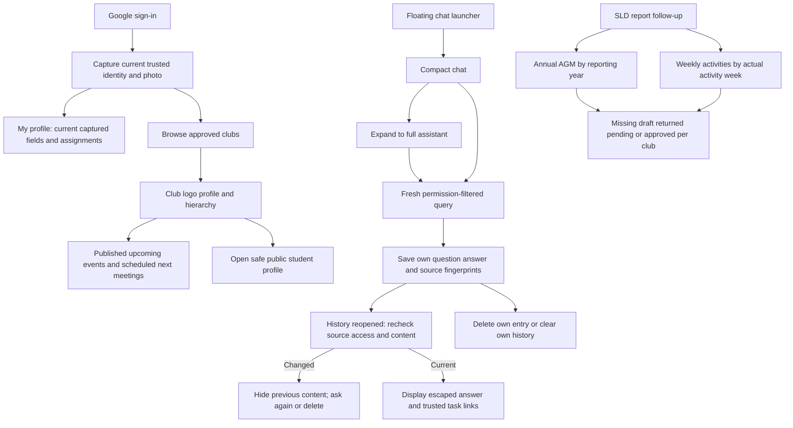

AGM uniqueness is per club/reporting year. A stale editable outgoing roster can be explicitly refreshed with a revision guard; historical signed evidence is retained. Public profile viewing and saved source links never grant operational permissions. See PROFILE_CHAT_REPORTS.md for exact API contracts.

## Weekly and AGM reports

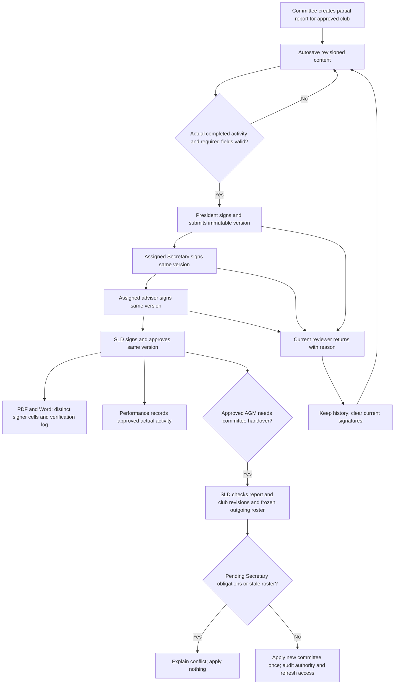

Four distinct current role holders sign in order. The AGM template's Prepared by Secretary, Checked by President and Reviewed by Advisor cells retain their original meanings; SLD verification is added separately. A corrected version requires all four fresh signatures. Handover never happens merely because the AGM was approved.

## Operational performance

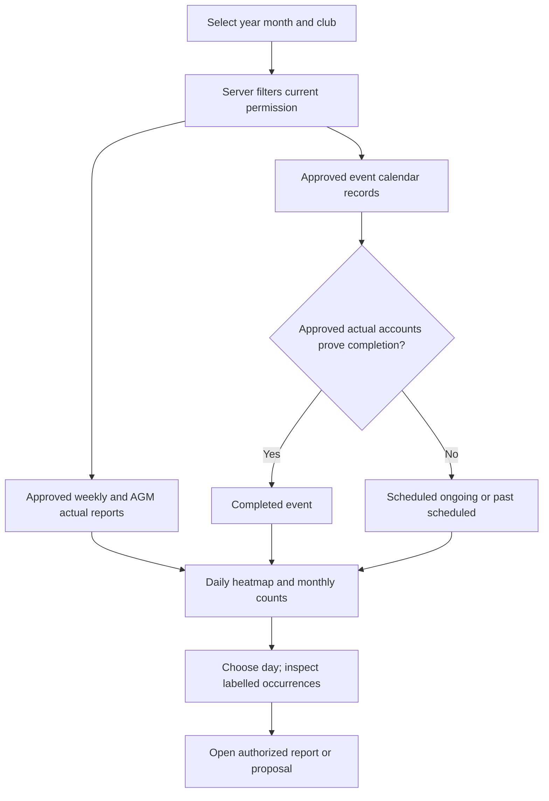

SLD can select all clubs. Linked committee/advisor views are scoped; event-only organisers see their events. Finance retains money charts; autosave and administrative actions do not fabricate meetings. Elapsed schedules alone are not proof of attendance or completion.

## Returned form and assistant navigation

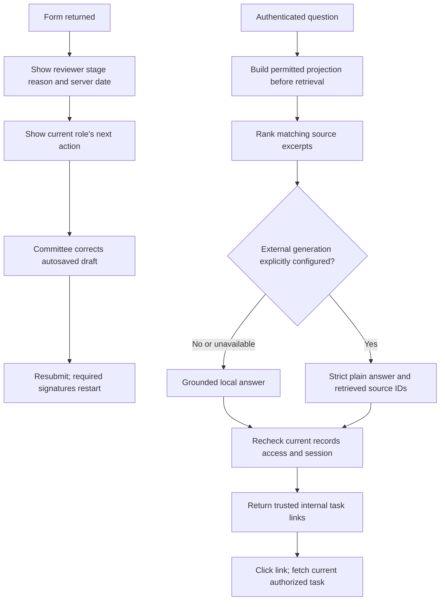

Ordinary students receive only safe published upcoming/ongoing events. Assigned committee/advisors receive their records; SLD receives all current records. The assistant has no mutation tools. Source changes during generation block the response rather than exposing stale private context.

Revision: 2026-10-09. Diagrams describe implemented club/proposal/admin, actual event accounts, signed reports, performance and assistant behavior. Membership collection/payments, financial adjustments, indemnity and Drive processes remain planned in PRD.md. FUNCTION_FLOWS.md maps each implemented feature to controllers, API handlers, permissions and failure paths.

## Event assignment and student work

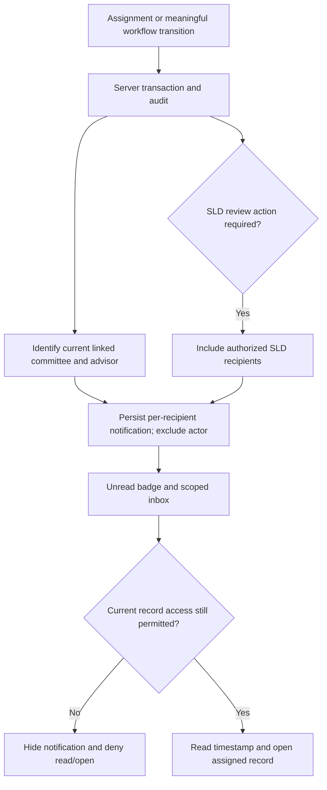

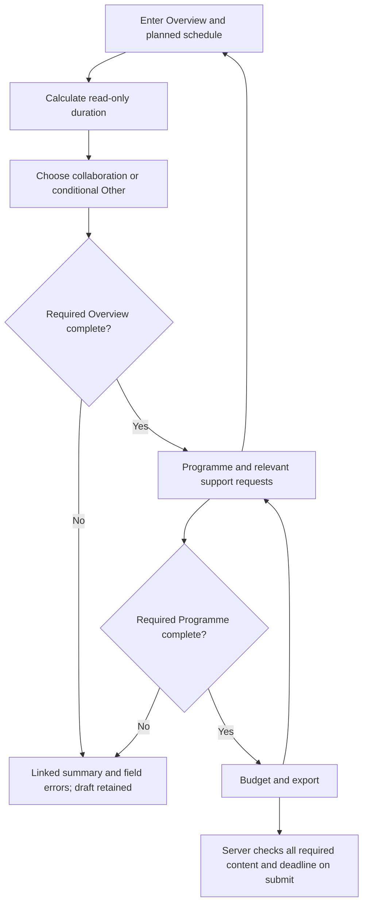

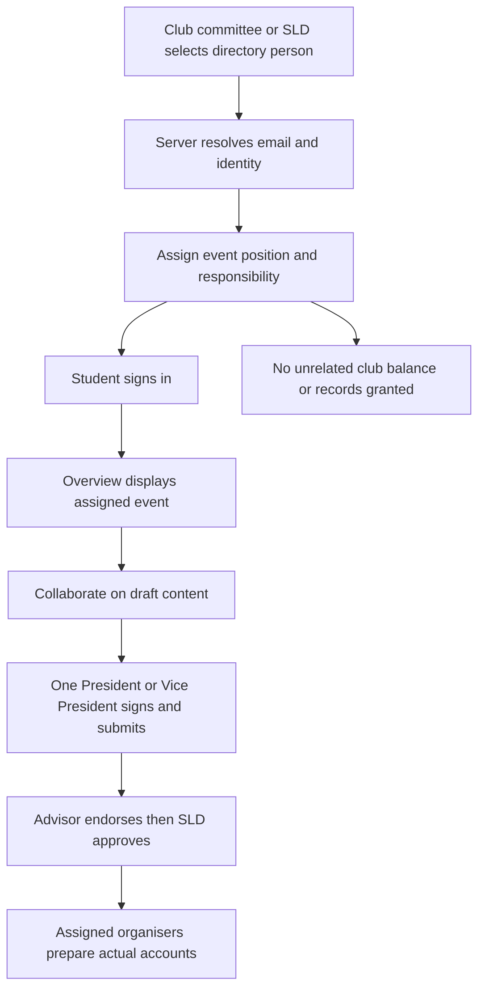

## Actual accounts and approved club balance

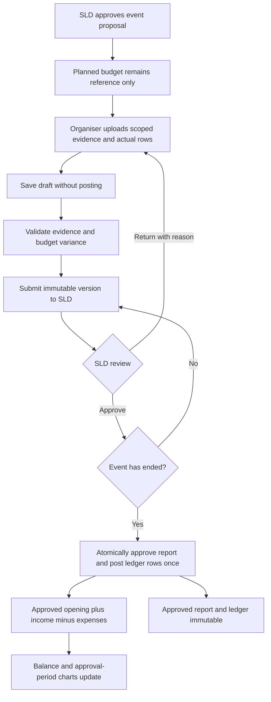

## Login and club permissions

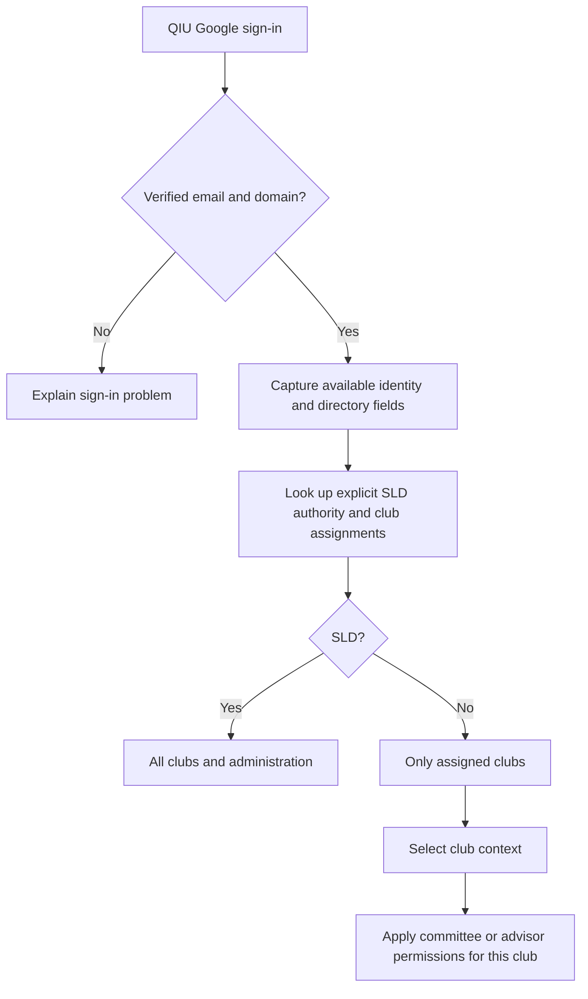

An advisor assignment does not change the user's roles in other clubs. Directory Staff classification does not grant SLD approval privileges.

## One-time club registration

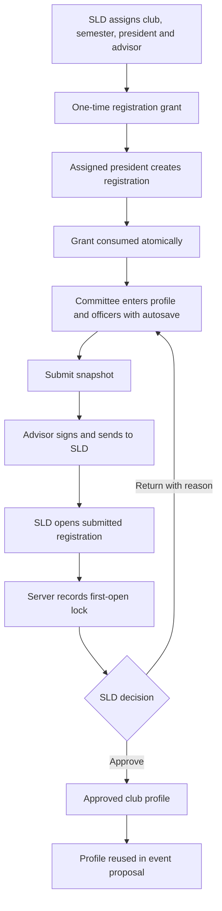

Pending edits before SLD first-open invalidate earlier endorsement and require renewed review. Historical signed snapshots remain. SLD cannot approve before advisor endorsement.

## Proposal autosave and session recovery

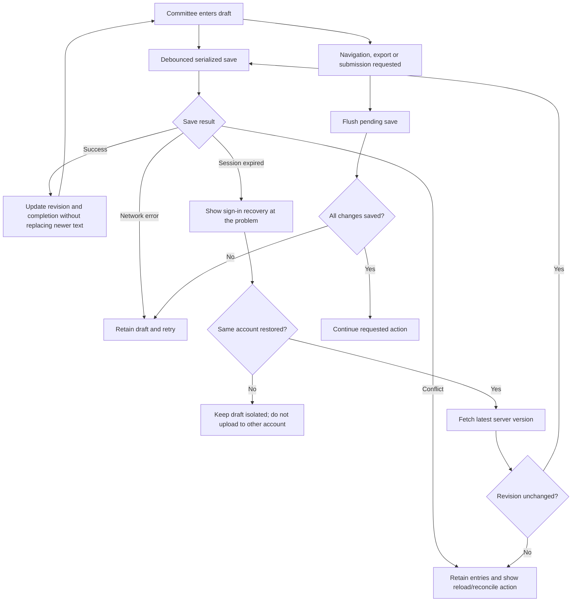

The gauge measures required fields, not approval. A forced browser close or network failure can prevent final delivery; the saved indicator is the evidence that the server accepted entries.

## Submission policy and urgent permission

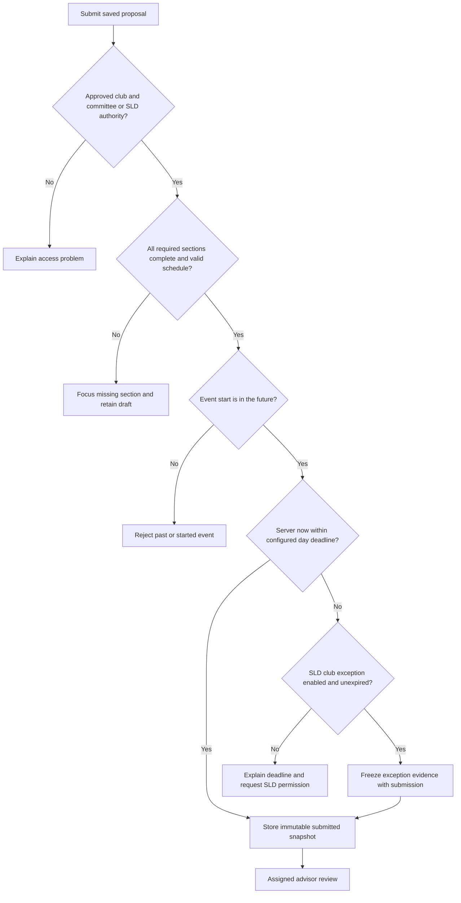

SLD configures days and grants/revokes a club permission with reason and expiry. Exceptions do not skip required fields or either approval stage.

## Proposal review and calendar

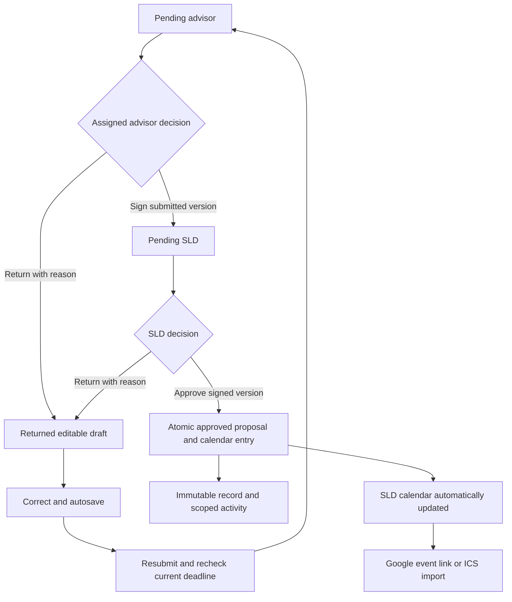

Approval uses the viewed record revision and submitted digest. A stale review is rejected. Google linking requires user confirmation; there is no connected live synchronization.

## Activity and directory

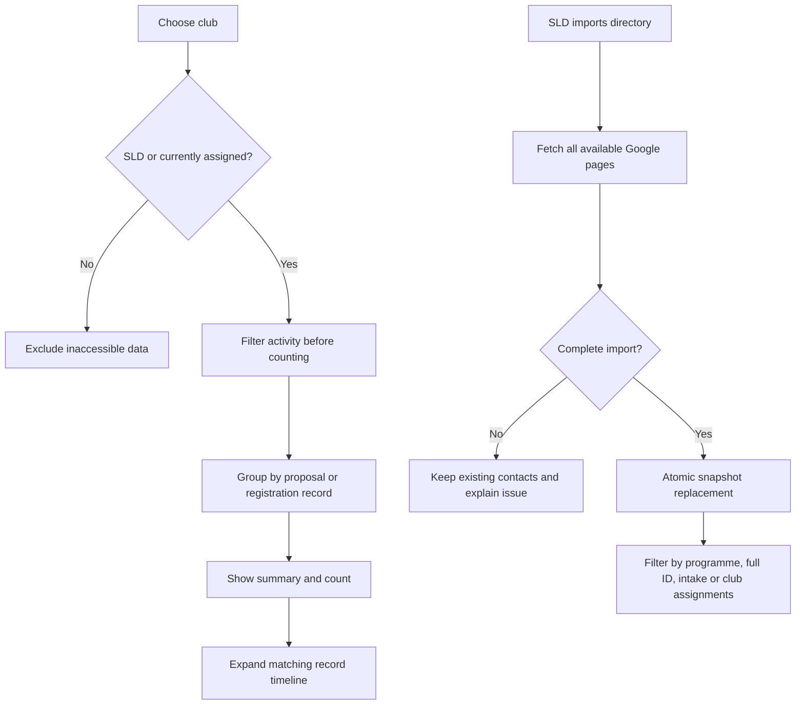

Photo URLs and missing-photo status are imported. Directory visibility is governed by university Google permissions. Club contact filtering means committee/advisor assignments until membership is implemented.

## Proposal signing and immutable dates

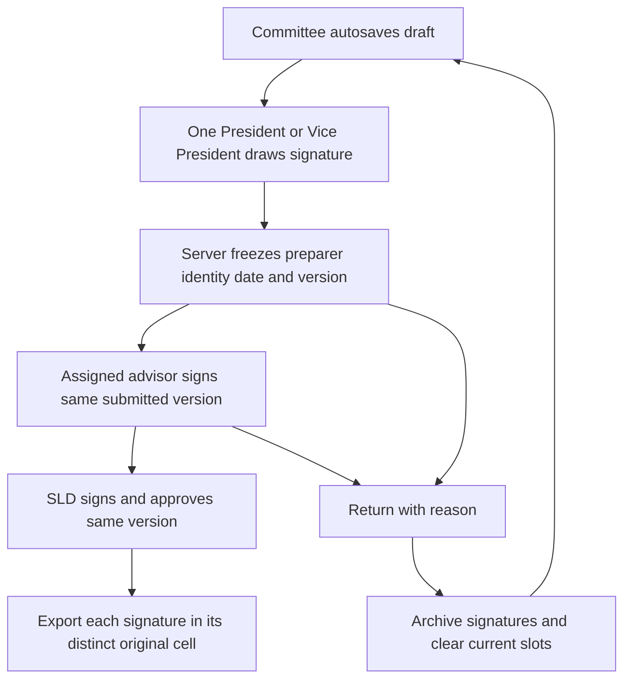

Proposal signatures now appear in three distinct original-table cells: Prepared by (President OR Vice President), advisor Reviewed by (top right), and SLD Reviewed by (previously blank second-row left). Exactly one preparer signs each submitted version. Names, designations and departments are captured from authenticated/trusted profiles; absent directory job titles use the actual application role (Club Advisor or SLD Officer), while absent departments show Unavailable. Dates come exclusively from server signing time and cannot be edited. Returns clear current signatures; immutable earlier signatures remain in history, and corrected submissions require fresh signatures. Printed registrar, bursar and COO cells remain separate and unsigned.
